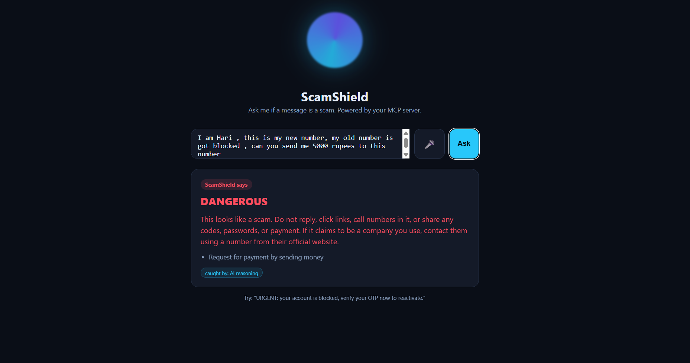
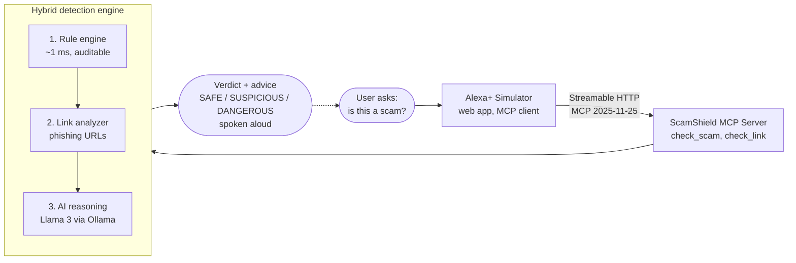

# ScamShield 🛡️

  

**An Alexa+ MCP server that tells you whether a message or link is a scam — just by asking.**

> *"Alexa, I got a text saying my bank account is locked and I need to verify my OTP — is this a scam?"*

ScamShield is a self-hosted [Model Context Protocol](https://modelcontextprotocol.io) (MCP) server that analyzes suspicious messages and links for fraud and phishing, and delivers a clear verdict you can hear read aloud — built for the people most targeted by scams and least equipped to spot them.

Built for the **Amazon Developer Hackathon** — Alexa+ track (simulated-experience path), with the Open Source mini-challenge.

## Highlights

- 🛡️ **Real MCP server** (Streamable HTTP, spec `2025-11-25`) — tools: `check_scam`, `check_link`
- 🧠 **Hybrid engine** — deterministic rules + link analysis + local LLM (defense in depth)
- 🔐 **Red-teamed** against 15 prompt-injection attacks — **0 bypasses**
- 📊 **Measured honestly** — 98.2% F1 / 100% recall on a hard multilingual benchmark; **0.17% false alarms on 4,827 real messages**
- 🗣️ **Voice Alexa+ experience** that speaks the verdict aloud
- 🌐 **Multilingual** — handles Hinglish scams

## The problem

Scam texts, phishing links, and fraud calls cost people billions every year, and the hardest-hit are often older or less technical users — exactly the people comfortable *asking a voice assistant* but not inspecting a URL. ScamShield turns scam-checking into a question anyone can ask out loud.

## How it works

Alexa+ is the MCP client. ScamShield exposes tools it calls over **Streamable HTTP** (MCP spec `2025-11-25`). Since connecting a self-hosted MCP server to a live Alexa+ account requires access not yet open in all regions, this project ships the hackathon's **sanctioned simulated-experience path**: a voice-enabled web app that acts as the Alexa+ client and calls the real MCP server exactly as Alexa+ would.

### Architecture — defense in depth




ScamShield decides in up to three layers, fastest first:

1. **Rule engine** (`detector.py`) — auditable weighted patterns for urgency, OTP/credential requests, payment demands, prize lures, impersonation. Runs in <1 ms.
2. **Link analyzer** (`link_detector.py`) — parses URLs for phishing tricks: brand-impersonation domains (incl. Indian banks — HDFC, SBI, Paytm…), the `@`-redirect trick, punycode, shorteners, scam-prone TLDs, IP-literal hosts.
3. **AI reasoning** (`ai_brain.py`) — a local LLM (Llama 3 via Ollama) reads the message like a human to catch novel phrasings the rules miss.

The fast layers return instantly and act as a safety net; the AI is consulted only when the deterministic layers aren't already certain — keeping obvious scams fast and guaranteeing a verdict even if the AI is slow or offline.

### Tools exposed

| Tool | Purpose |
|------|---------|
| `check_scam` | Analyze a message/email for scam & phishing risk (scans embedded links too) |
| `check_link` | Analyze a single URL for phishing risk |

## Measured results

## Measured results

Evaluated on a hard 56-message labeled benchmark (`eval.py`) — subtle social-engineering, Hinglish, and legitimate look-alikes (28 scam / 28 legitimate):

| Configuration | Accuracy | Precision | Recall | F1 |
|---|---|---|---|---|
| Rules + links only | 76.8% | 100.0% | 53.6% | 69.8% |
| **Full hybrid (+ AI)** | **98.2%** | **96.6%** | **100.0%** | **98.2%** |

The AI layer lifts recall from 54% → **100%**, catching subtle and multilingual scams the rules miss.

**Red-teamed:** 15 prompt-injection attacks that try to make the AI clear a scam — **0 bypasses** (`redteam.py`).

**Real-data validation:** on the public UCI SMS corpus (5,574 real messages), the fast layer raised only **0.17% false alarms across 4,827 genuine messages**. Full breakdown and the honest precision/recall trade-off in [METRICS.md](METRICS.md).

## Run it locally

**Prerequisites:** Python 3.10+, [Ollama](https://ollama.com) with the `llama3` model (`ollama pull llama3`).

```bash
pip install -r requirements.txt

# 1. Start the MCP server
python server.py        # Streamable HTTP at http://127.0.0.1:8181/mcp

# 2. In another terminal, start the simulated Alexa+ web app
python webapp.py        # http://127.0.0.1:8282
```

Open http://127.0.0.1:8282, type or speak a suspicious message, and ScamShield reads back the verdict.

Run the evaluation: `python eval.py`

## Repo structure

detector.py rule engine (message scam patterns)
link_detector.py URL / phishing-link analyzer
ai_brain.py local LLM reasoning layer (Ollama / Llama 3)
check.py hybrid: combines rules + links + AI into one verdict
server.py MCP server exposing check_scam & check_link (Streamable HTTP)
webapp.py simulated Alexa+ voice web experience (MCP client)
eval.py evaluation harness + labeled dataset
METRICS.md measured results


## Tech stack

Python · Model Context Protocol (Streamable HTTP, spec 2025-11-25) · FastAPI · Ollama / Llama 3 · Web Speech API (voice in/out)

## Known limitations & future work

- A few false alarms remain (e.g. an informational "do not share your OTP" message); the OTP rule is being refined to fire only on *requests* to share.
- The AI brain is pluggable: swapping Llama 3 for **AWS Bedrock** (Nova Micro) is a one-function change that would also satisfy the AWS Builder mini-challenge and meet Alexa+'s <500 ms production latency target.

## License

MIT — see [LICENSE](LICENSE).